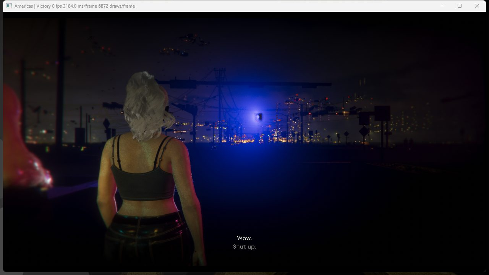

# mangrove

**mangrove** runs the Xbox Series X|S (GDK) build of GTA VI natively on Windows PCs with
**8 GB NVIDIA graphics cards**, from game files you supply yourself. It is
[hyphennn's victory-fork](https://github.com/fxceless/victory-fork) (itself a fork
of [Marvisak's VIctory](https://github.com/Marvisak/VIctory)) with settings
tuned for 8 GB NVIDIA cards and an easy-to-read status window.

> [!IMPORTANT]
> **This repository contains no game files, shaders, dumps or assets, and none
> will ever be provided — not here, not in issues, not by request.** You need
> your own copy of the game. Not affiliated with or endorsed by its developer
> or publisher.

## Status (2026-11-25)

Tested on Windows 11 with an **NVIDIA GeForce RTX 3070 (8 GB)**, Ryzen 5 2600, 32 GB RAM:

| | |
|---|---|
| Boot, first-boot setup (subtitles, language), menus | ✅ works, 30 fps |
| Opening credits | ✅ render in colour |
| Opening cinematic | 🟡 **renders in 3D** once the shader cache is warm; flickers in places |
| Frame rate | 🟡 30 fps in menus; low single digits in 3D scenes |
| Known problems | ❌ anything in shadow is black (the game's ray-traced lighting does not run yet); subtitles flicker; the first run is mostly black while shaders and pipelines are built (they are cached after that, so each run shows more) |


*Opening cinematic in 3D on an RTX 3070 8 GB (warm cache).*

## What mangrove adds

| | |
|---|---|
| `pc\play.bat` | one-click launcher with the 8 GB NVIDIA settings below |
| `pc\easy-view.ps1` | replaces the raw log with a plain-English window: speed, objects drawn, objects skipped (not ready yet), shaders ready, files loaded, and red **PROBLEM** lines for GPU resets or out-of-memory |
| `victory warm` | pre-translates every shader and pre-builds the compute pipelines before you play (ported from leonida-victory), so the first run is not mostly black |
| `VICTORY_POOL_NO_ASSERT=1` | gets past the crash about 6-8 minutes into the opening cinematic (below); on in `play.bat` |
| `pc\second-monitor.ps1` | puts the game window on your second monitor at 1280×720 without stealing focus |

Settings used by `play.bat`:

| Switch | Why |
|---|---|
| `VICTORY_TEXTURE_GUARD=0` | stops repeated/flickering frames on NVIDIA (fork issue #269) |
| `VICTORY_SHADER_OPT=0` | removes black mosaic blocks (#310) |
| `VICTORY_CARD_BUFFERS_MB=512` | keeps card buffers inside 8 GB of video memory |
| `VICTORY_LOG=info,…descriptor::host=error` | mutes one warning NVIDIA repeats ~300,000 times |

## Getting past the 8-minute crash

About 6-8 minutes into the opening cinematic the game stops itself (`0x80000003`,
exit code -2147483645) on every worker thread at once. The title's own crash
report shows its `INSTANCE_LIST` pool full (45000/45000); the stop is an `int3`
in the game's lock-free pool allocator when the free list is empty (the
free-list head reads the end marker `0x1fffe`). It happens at a fixed point in
the cinematic, not after a time-out, and more RAM or a bigger paging file does
not help: the pool size is fixed in the game. Tracked in
[VIctory #698](https://github.com/Marvisak/VIctory/issues/698).

`VICTORY_POOL_NO_ASSERT=1` (in `crates/victory-loader/src/pool_asserts.rs`)
writes a NOP over each pool-empty `int3` right after the game is mapped, so the
allocation returns null instead, as the allocator already does on its own
early-out. The approach is WalliceCariasPerussio's (17+ minutes in the world
on an RTX 5060). mangrove's version finds the sites itself in the mapped code
(every allocator copy pops its free list with a 17-bit `and r32, 0x1ffff` next
to a `lock cmpxchg`; each nearby jump landing on `int3` + `xor r, r` is a site),
so **no list derived from the game is shipped**. It runs only on the build it
was checked on, and it is a workaround: a caller that does not expect null
could still fault later.

## Requirements

- Windows 10/11 x64, a CPU with AVX2
- An NVIDIA RTX card (20 series or newer: shader model 6.6 and mesh shaders), 8 GB or more
- 32 GB RAM recommended; a large Windows paging file (error 1455 means it is too small)
- Rust (see `rust-toolchain.toml`)
- Your own copy of the game

## Build

```powershell
cargo build --release -p victory
```

## Play

1. Open `pc\play.bat` in a text editor and set `GAME=` to your own game executable.
2. Optional, once: `target\release\victory.exe warm <game folder>\shaders.rpf <game folder>\game_scarlett_master.exe` (with the same `VICTORY_*` settings and cache folder as `play.bat`) to pre-build shaders.
eleaseictory.exe warm <game folder>\shaders.rpf <game folder>\game_scarlett_master.exe` (with the same `VICTORY_*` settings and cache folder as `play.bat`) to pre-build shaders.
3. Double-click `pc\play.bat`.
4. Leave the opening cinematic running for a while on the first run: the 3D
   fills in as pipelines are built and saved. The **Skipped** number in the easy
   view drops run after run.

Controller: XInput pads. With no pad, the keyboard acts as one while the game
window has focus (Enter = A, Backspace = B, Esc = Menu, arrows = D-pad, WASD =
left stick).

## Credits

mangrove only adds a launcher, the easy view and 8 GB NVIDIA settings. **All of
the emulation work belongs to these people:**

| Who | What |
|---|---|
| **[Marvisak](https://github.com/Marvisak)** and the [VIctory contributors](https://github.com/Marvisak/VIctory/graphs/contributors) | [VIctory](https://github.com/Marvisak/VIctory): the compatibility layer itself (PE loader, kernelx / xgameruntime stand-ins, RDNA2 shader translation to DXIL, D3D12.X graphics layer) |
| **hyphennn** ([fxceless](https://github.com/fxceless)) and the [victory-fork contributors](https://github.com/fxceless/victory-fork/graphs/contributors) | [victory-fork](https://github.com/fxceless/victory-fork): the rendering and speed fixes mangrove is built on |
| **[Zettrox](https://github.com/Zettrox)** | [ztrx](https://github.com/Zettrox/ztrx): showed this code reaching the world on an 8 GB NVIDIA card (RTX 3050) |
| **[mauri9911](https://github.com/mauri9911)** and myokex | [leonida-victory](https://github.com/mauri9911/leonida-victory): testing help, NVIDIA shortcuts and the `victory warm` command ported here |
| **[WalliceCariasPerussio](https://github.com/WalliceCariasPerussio)** | the pool-assert workaround (VIctory #698) that `VICTORY_POOL_NO_ASSERT` re-implements |
| The VIctory #698 reporters (Sil3ntGam3r, LAKSHYA-cmd-tech, likecrank-dotcom, VibeClauding, VoidDeficit, Sunkiller-qc and others) | pinned the 8-minute stop to the `INSTANCE_LIST` pool |
| The people who reported victory-fork issues #269 and #310 | found the texture-guard and shader-optimiser switches used in `play.bat` |
| **[4lwayz](https://github.com/4lwayz)** | [PortWatch VI](https://portwatch-vi.xyz), which tracks all of these efforts |

The fork's own README is kept in
[`docs/victory-fork-README.md`](docs/victory-fork-README.md).

Made with AI assistance ([Claude Code](https://claude.com/claude-code)).

## License

GPL-3.0, as upstream. See [LICENSE](LICENSE).
